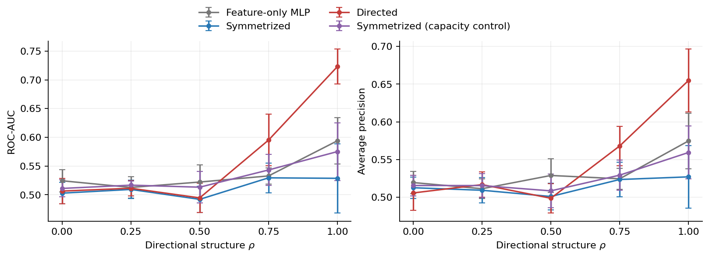
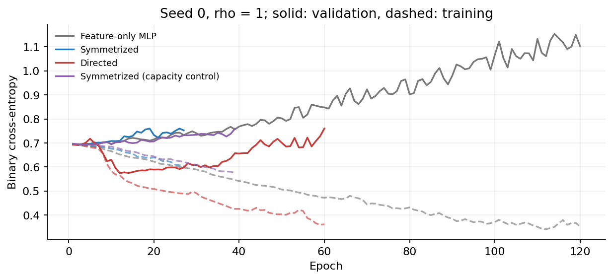

# Baseline experiment

## Objective

Test whether separate incoming and outgoing mean aggregation improves directed edge recovery as directional structure increases, with a shared ordered-pair decoder architecture.

## Configuration

180 vertices; six features; three equally sized latent roles; skeleton edge probability 0.15; feature-noise standard deviation 1. Five orientation strengths and five seeds give 100 runs across four models. Generated graphs contain 2324–2474 directed edges. The encoder receives no ground-truth role indices.

The full configuration and software versions are recorded in `metadata.json`. The training protocol and reproducing commands are documented in `code/README.md`.

## Results

Values below are test means ± sample standard deviations at maximum directional strength.

| Model | Parameters | ROC-AUC | Average precision |
| --- | ---: | ---: | ---: |
| Feature-only MLP | 3393 | 0.594 ± 0.041 | 0.575 ± 0.037 |
| Symmetrized | 4609 | 0.529 ± 0.060 | 0.527 ± 0.042 |
| Directed | 5825 | 0.723 ± 0.030 | 0.655 ± 0.042 |
| Symmetrized (wide) | 5841 | 0.575 ± 0.050 | 0.559 ± 0.035 |

At rho = 1, the directed model reaches ROC-AUC 0.723 ± 0.030 and AP 0.655 ± 0.042; the capacity control reaches ROC-AUC 0.575 ± 0.050 and AP 0.559 ± 0.035. The paired Dir-minus-SymWide differences are 0.148 ± 0.020 for ROC-AUC and 0.095 ± 0.009 for AP.

The directed encoder does not show a consistent advantage at weak directional structure. The main separation occurs at rho = 1. This is evidence for the specified synthetic generator and protocol, not a claim of superiority on real-world benchmarks.

Cumulative training and evaluation time: 71.9 seconds on CPU with one thread; data generation, file writing and plotting are excluded. Individual timings are recorded in `runs.csv`.

All per-run measurements, including weaker directional settings, are retained in `runs.csv`. Error bars show sample standard deviations over five runs.
