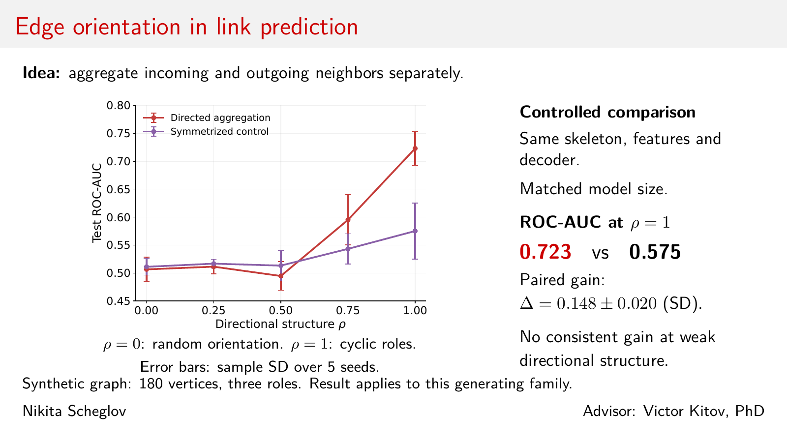

# One-slide talk

- [Slide PDF](main.pdf)
- [LaTeX source](main.tex)
- [Talk text in Russian](talk_ru.md)
- [Numerical results](../results/summary.csv)

The slide shows the directed encoder and the symmetrized control with a matched parameter budget. Both use the same decoder architecture. Error bars show sample standard deviations over five seeds. The result concerns the synthetic generating family described in the article.



## Build

From the repository root, regenerate the numerical inputs and figures without retraining:

```bash
python code/reporting.py
python code/plot_results.py
latexmk -cd -pdf -interaction=nonstopmode -halt-on-error slides/main.tex
```

To reproduce the experiment and compile both the article and slide:

```bash
python code/main.py --build-pdfs
```

The PDF build requires TeX Live with Beamer and `latexmk`, in addition to the Python dependencies in `code/requirements.txt`.
